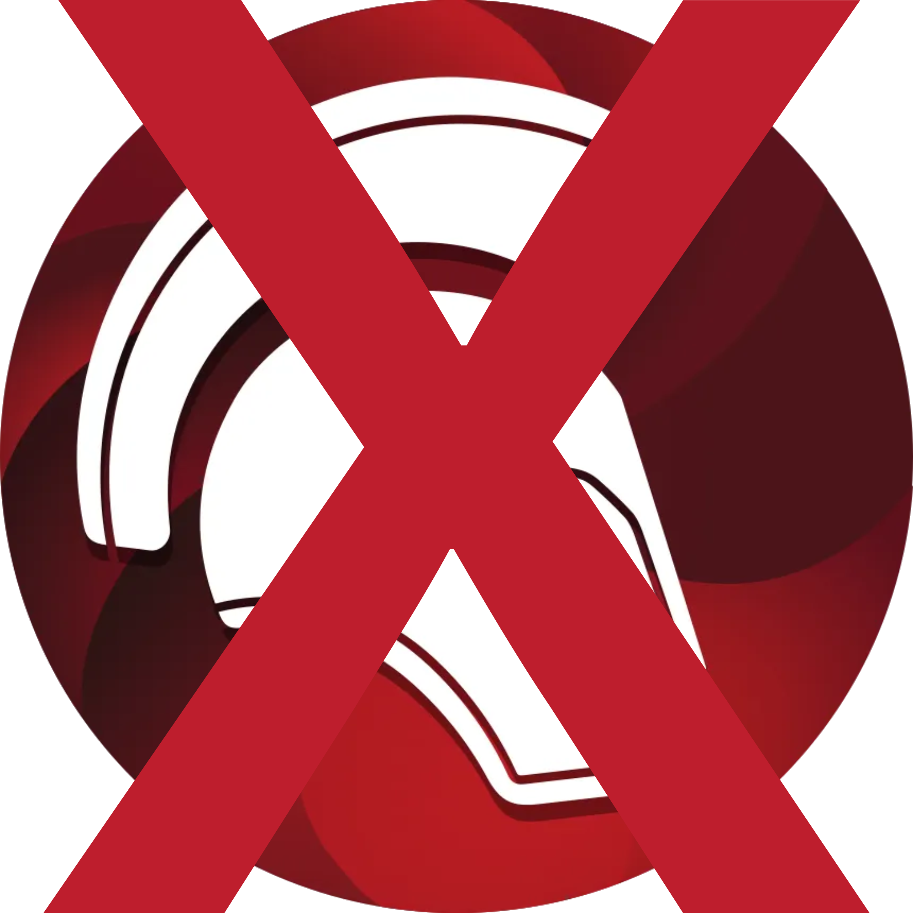

<p align="center">
  
</p>
<h1 align="center">Undelphi</h1>

A Java tool (Swing + CLI) that runs Ghidra under the hood to extract forms, SQL queries, and business logic from compiled Delphi (Win32) executables, assisting in the migration to **Vue.js** + **Go** (while translating Oracle queries to PostgreSQL).

> **Note on development:** This project is being built in pair programming with AI (Claude / LLMs). Architecture decisions, scope, and testing against real binaries are driven manually, while most of the Java boilerplate, Ghidra API integration, and parsers were generated and iterated with AI to speed up delivery.

## The problem

We have several legacy `.exe` applications compiled in Delphi (such as Delphi 10 Seattle) with no access to the original `.pas` source code, all talking directly to an Oracle database. Reverse engineering each binary by hand in Ghidra takes weeks per routine.

The goal of `undelphi` isn't to be a magical 100% automated converter (which doesn't work in practice due to heavy VCL/DevExpress usage and database-side triggers/packages), but rather to automate everything that is deterministic and digest the rest:

1. **Forms (`DFM`):** Stored as `RCDATA` resources (`TPF0`) inside the `.exe`. We can extract the full component tree deterministically and generate Vue.js component skeletons directly from it.
2. **SQL Queries (`TOraQuery`, `TOraSQL`, `TFDQuery`):** Also stored in plain text/binary inside the DFMs. We can extract all of them, map tables and columns, separate read queries (`SELECT`) from writes (`INSERT`/`UPDATE`), and translate the Oracle dialect to our PostgreSQL mirror using a target mapping profile.
3. **Native code (button handlers, calculations):** Since Delphi 2010+ embeds extended RTTI in the binary, we can cross-reference DFM events (e.g., `OnClick = btnGravarClick`) with VMT/RTTI tables, locate the exact function address in Ghidra, decompile only the handlers that matter, and lift the business rules into Go.

## How it works

```text
.exe (Delphi Win32)
 ├── [PE / RCDATA] ──► Binary DFM Parser (TPF0) ──► Component tree ──► Vue.js SFC
 │                                              └──► Raw SQLs ──► SQL/PL-SQL parser ──► Target Mapping (Postgres) + Go
 └── [Ghidra Headless] ──► VMT / Extended RTTI ──► Event-to-address mapping ──► Decompiler ──► Go Services
```

## Requirements

- **Windows** (scripts are `.cmd` due to local GPO restrictions on `.ps1`)
- **JDK 21** (Ghidra 12.1.4 requirement)
- **Ghidra 12.1.4 PUBLIC** extracted locally (JARs are referenced directly from the Ghidra installation folder, not copied into the repo)
- **Go 1.22+** (optional, only to build/test the generated Go code; tests fall back to the `golang:1.22-alpine` Docker image)

Check `gradle.properties` or the `.cmd` scripts if your JDK or Ghidra paths differ from the defaults on the dev machine.

## Building and running

Build and run tests:

```cmd
build.cmd
```

Build the Windows executable (bundled Java runtime, Ghidra splash-style startup screen):

```cmd
exe.cmd
```

It produces `build\exe\Undelphi\Undelphi.exe` (GUI) and `undelphi-cli.exe` (console, same commands as `undelphi.cmd`). Ghidra JARs are not copied into it: the executable references the local Ghidra installation, which Ghidra needs anyway for its native decompiler and processor specs. Copy the whole `build\exe\Undelphi` folder to run it elsewhere (same Ghidra path required).

Open the Swing GUI:

```cmd
undelphi.cmd
```

Or open the GUI with an executable already loaded:

```cmd
undelphi.cmd gui C:\path\to\app.exe
```

### CLI mode

Quick triage (detects Delphi version, architecture, form count, and embedded 3rd-party libraries like DevExpress, ODAC, FireDAC, ReportBuilder):

```cmd
undelphi.cmd info C:\path\to\app.exe
```

Import the binary into the embedded headless Ghidra engine and print program summary (sections, compiler spec, function count):

```cmd
undelphi.cmd ghidra C:\path\to\app.exe
```

Extract and generate:

```cmd
undelphi.cmd forms    C:\path\to\app.exe out    :: every DFM as text (out/forms)
undelphi.cmd sql      C:\path\to\app.exe out    :: SQL from components (out/sql)
undelphi.cmd vue      C:\path\to\app.exe out    :: Vue screens (out/vue)
undelphi.cmd oracle   C:\path\to\app.exe out    :: Oracle map + gap report (out/oracle)
undelphi.cmd go       C:\path\to\app.exe out    :: Go module: runtime, queries, rules (out/go)
undelphi.cmd exportar C:\path\to\app.exe out --perfil profile.yaml   :: everything, including F3/F4
```

`exportar` options: `--perfil <yaml>` (target mapping profile), `--modulo <go module>`, `--sem-ghidra` (skip decompilation and handler lifting).

## Target profile

Maps Oracle tables/columns to the PostgreSQL target. Connection values come from environment variables (`${VAR}` / `${VAR:-default}`); a literal password is rejected.

```yaml
nome: target-mirror
conexao:
  driver: postgres
  host: ${PGHOST}
  porta: ${PGPORT:-5432}
  banco: ${PGDATABASE}
  usuario: ${PGUSER}
  senha: ${PGPASSWORD}
escrita: bloqueada          # bloqueada (read-only) | permitida
colunas_padrao: minusculas  # unmapped columns: minusculas | igual | lacuna
tabelas:
  ORACLE_TABLE:
    destino: pg_table
    colunas:
      ORACLE_COL: pg_col
      NO_EQUIVALENT: ~      # becomes a gap
```

Anything without a safe translation becomes a **gap**: the generated Go function keeps its signature and returns `undelphirt.ErrLacuna` explaining why, so calling code always compiles.

## Roadmap

- [x] **F0 — Foundation:** Gradle setup, embedded Ghidra 12.1.4 (`borlanddelphi` compiler spec), Delphi version & library detector, Swing skeleton + CLI.
- [x] **F1 — Forms & SQL Inventory:** Binary DFM (`TPF0`) parser, DevExpress/VCL to Vue component mapper, and SQL extractor/classifier (reads vs. writes, Oracle packages/procedures).
- [x] **F2 — Target Profile & Go Queries:** YAML mapping profile (schema/table/column translation, credentials via env vars), Oracle-to-PostgreSQL translator (`NVL` -> `COALESCE`, `DECODE` -> `CASE`, `(+)` -> `LEFT JOIN`), gap report against the Postgres mirror, and Go repository generator.
- [x] **F3 — Delphi Structure (VMT/RTTI):** Parse Delphi 10 Seattle extended RTTI and VMTs, link DFM `published` events (`OnClick`, etc.) to function addresses, and filter out RTL/VCL/DevExpress library code.
- [x] **F4 — Handler Lifting to Go:** Decompile event handlers via Ghidra's `DecompInterface` and lift business logic into Go services/endpoints wired to the Vue stubs.
- [x] **F5 — Differential Validation:** Run extracted Go rules against real dataset samples and compare outputs against the legacy application.

### Known limitations

- Delphi RTL internals (string/exception helpers) stay unnamed (`FUN_...`) in the decompiled C: there is no Delphi install to build signatures.
- F4 lifts data access (parameters bound to screen fields, `AddWhere`, `SQL.Add`-built queries, `Open`/`ExecSQL`). Validations, Pascal calculations and visual changes are marked `REVISAR` with the original C alongside.
- ReportBuilder reports are only listed.
- Ghidra cannot initialize inside Gradle's test worker; acceptance tests run the CLI in a separate JVM.

## License

Internal tool for legacy documentation and migration. Planned to be released under Apache 2.0 once internal specifics and target profiles are decoupled.
